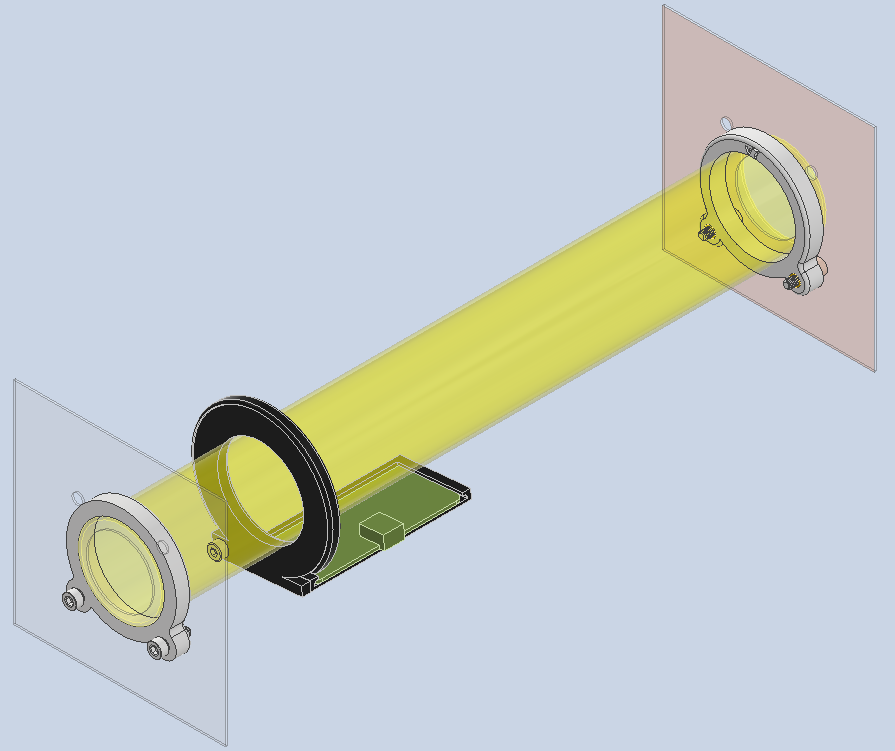
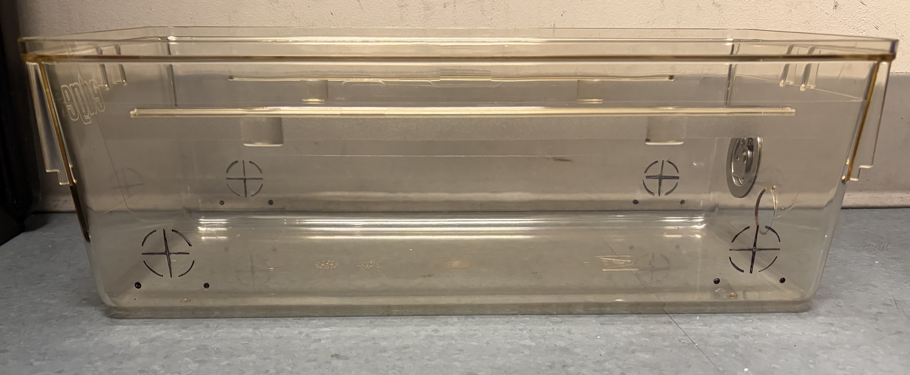

# Cage connector

### Materials
| | |
| - | - |
| cage_connector_03 | 3D printed |
| Screws (x2) | M3 x 10 |
| M3 heat-set inserts (x2) |  |

### Assembly instructions

Mark cage hole positions using 3D printed templates  
([template_holes_02](template_holes_02.ipt))
([template_holes_02_rev](template_holes_02_rev.ipt))

Use step drill bit to make (x1) large hole for tube and (x2) small holes for M3 screws.  

Large hole: **1"** diameter  
M3 through-holes: **3/16"** diameter
